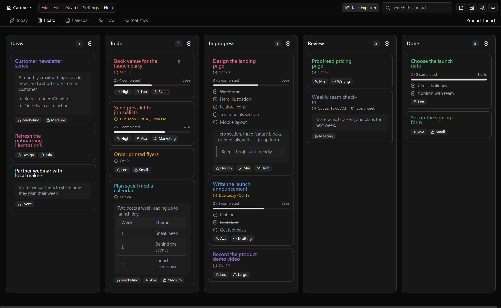
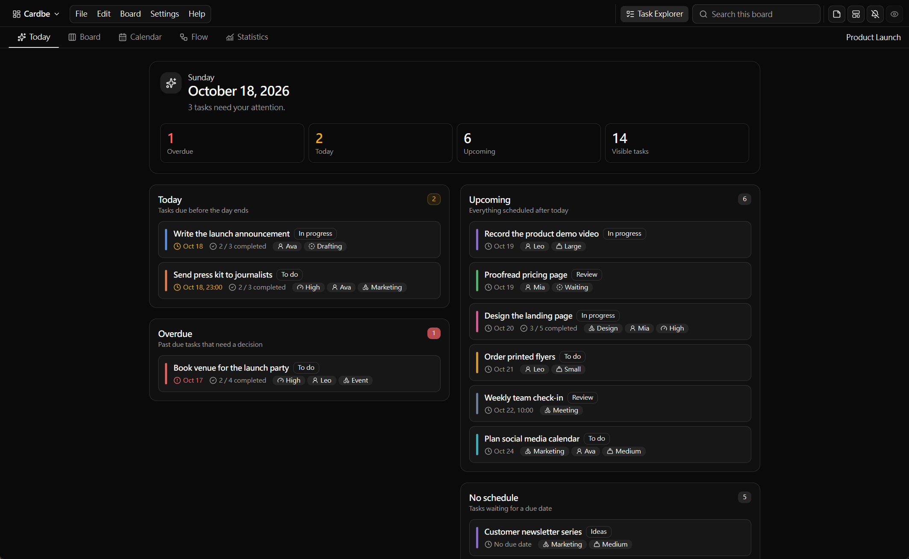
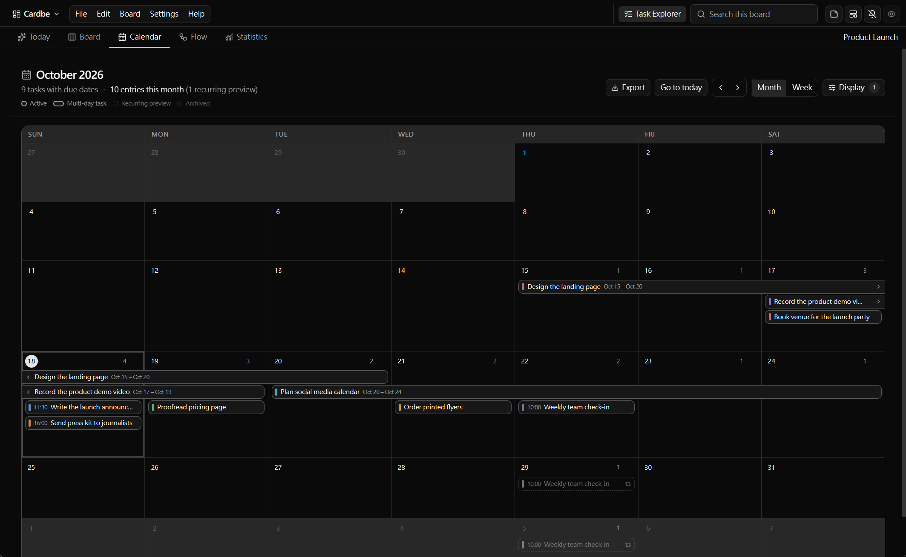
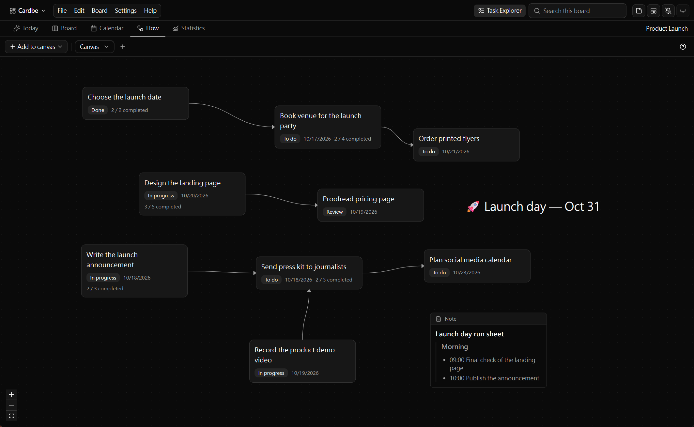
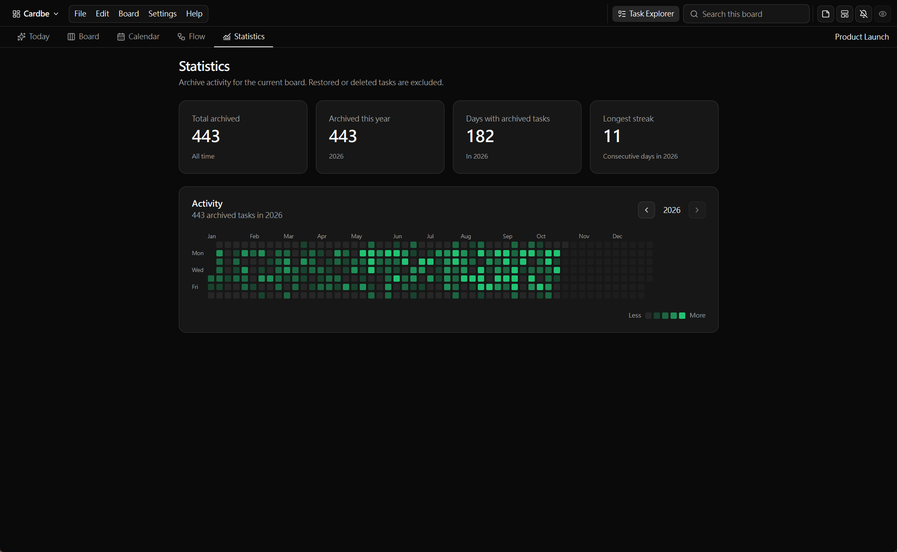
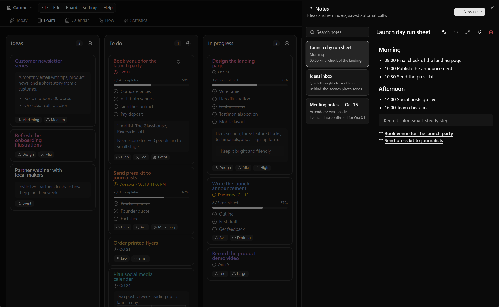

  

<h1 align="center">Cardbe</h1>

  <strong>A calm, private task board that lives on your computer.</strong> 
  Plan your work on cards, see your day at a glance, and share a board only when you want to.

  <a href="https://github.com/ldslds449/Cardbe/releases/latest">Download for Windows</a> ·
  <a href="docs/sharing-and-privacy.md">Privacy</a> ·
  <a href="docs/development.md">Build from source</a>

  

---

## Why Cardbe?

- **Your data stays with you.** Everything is saved on your own computer. No account, no subscription, no cloud required.
- **Works offline.** Create, edit, and organize tasks without an internet connection.
- **Simple to start, room to grow.** Begin with a few columns of cards, then add notes, schedules, checklists, and more as you need them.

## What you can do

### Organize work your way

- Create as many boards as you like, each with your own columns.
- Drag and drop cards to reorder them or move them between columns and boards.
- Add labels, checklists, start and due dates, recurring schedules, and rich-text descriptions.
- Pin important cards, archive finished ones, and restore them anytime.
- Save frequently used cards as templates.

### See your work from different angles

| View           | What it shows                                                          |
| -------------- | ---------------------------------------------------------------------- |
| **Board**      | Your columns and cards, the classic Kanban layout.                     |
| **Today**      | What is due today, what is overdue, and what is coming up next.        |
| **Calendar**   | Your tasks on a monthly or weekly calendar, including multi-day tasks. |
| **Flow**       | A free-form canvas to arrange cards, draw arrows, and add notes.       |
| **Statistics** | How much you have finished and how your work has progressed.           |

<table>
  <tr>
    <td width="50%"> 
<b>Today</b> — know what needs attention first
</td>
    <td width="50%"> 
<b>Calendar</b> — plan your month at a glance
</td>
  </tr>
  <tr>
    <td width="50%"> 
<b>Flow</b> — map out what depends on what
</td>
    <td width="50%"> 
<b>Statistics</b> — see your progress over time
</td>
  </tr>
</table>

### Capture ideas instantly

- Use a global keyboard shortcut to add a task or a note from anywhere, even when Cardbe is in the background.
- Keep quick Markdown notes alongside your boards.
- Pop a task out into a small floating window to keep it in sight while you work.

  

### Find anything quickly

- Search across titles, descriptions, labels, and checklists — even if you only remember a few letters of a title.
- Browse every task across all boards in one place, then filter and sort it the way you need.

### Share when you choose to

- **Show a few cards** to people on the same Wi-Fi with a temporary, read-only link.
- **Invite others to a whole board** with a link or QR code. Invite them as viewers, or as editors who can make changes with you. Changes sync automatically, and edits made while offline are merged when everyone reconnects.
- Stop sharing at any time.

Sharing is always off until you turn it on. Learn more in [Sharing and privacy](docs/sharing-and-privacy.md).

### Make it yours

- Choose from light, dark, and a range of soft Morandi color themes.
- Use Cardbe in English or Traditional Chinese (繁體中文).
- Back up and restore your boards, and export your calendar.
- Extend Cardbe with optional plugins, such as syncing tasks with other services. Plugins run in a sandbox and must ask for your permission before connecting to the internet.

## Get Cardbe

1. Go to the [latest release](https://github.com/ldslds449/Cardbe/releases/latest).
2. Download the Windows installer, or the portable `.exe` if you prefer not to install anything.
3. Open Cardbe and create your first board.

> [!NOTE]
> Cardbe is not code-signed yet, so Windows may show a "Windows protected your PC" message the first time you open it. Select **More info**, then **Run anyway**. Only do this for files downloaded from the official [Releases page](https://github.com/ldslds449/Cardbe/releases).

Cardbe currently provides ready-to-use downloads for Windows. Developers can [build it from source](docs/development.md).

## Privacy at a glance

- Your boards, tasks, and notes are stored only on your computer.
- Cardbe does not collect analytics and does not require an account.
- Cardbe goes online only to check for updates, to preview a link you hover over, or when you turn on sharing or a plugin that needs it.

See [Sharing and privacy](docs/sharing-and-privacy.md) for the details.

## For developers

- [Development guide](docs/development.md) — setup, scripts, and project structure
- [Sharing and privacy](docs/sharing-and-privacy.md) — how LAN sharing and shared boards work
- [MCP server](docs/mcp-server.md) — connect local AI tools to your boards
- [Plugin API](https://github.com/ldslds449/cardbe-plugin-api) — build your own Cardbe plugin

## License

Cardbe is released under the [Apache License 2.0](LICENSE). See [NOTICE](NOTICE) for third-party components.
